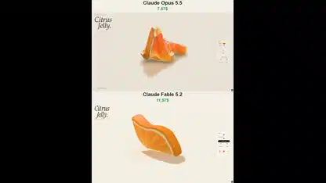

<!-- Generated by scripts/build.py. -->

# Two models make an interactive orange jelly

[Back to collection](https://github.com/VibeClip/awesome-fable-5-2-videos/blob/main/README.md)

**[▶ Watch](https://video.twimg.com/amplify_video/2121646347770015745/vid/avc1/1080x1400/oYsA5ldV906FI0dm.mp4?tag=29)** · [Original post](https://x.com/vib3coded/status/2121646685319221546)

[vib3coded](https://x.com/vib3coded) · 0:17 · 2026-11-14

The creator compares Fable 5.2 and Opus 5.5 on the same brief. The recording shows the two jelly slices deforming. The published prompt specifies WebGPU and WGSL.

## Shared prompt

The creator shared a prompt at the link below. Read it in its original context, with any references and follow-up instructions.

[Read the creator’s prompt](https://x.com/vib3coded/status/2121646834611331214)

Sources & verification

- Model evidence: Model named in original post
- Post availability checked: 2026-11-14 — Post available

Source availability and video generation are separate checks. Generation and rendering were not independently reproduced.

[License & media rights](https://github.com/VibeClip/awesome-fable-5-2-videos/blob/main/docs/MEDIA-RIGHTS.md)

