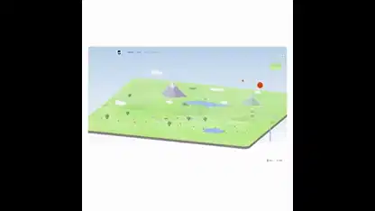

<!-- Generated by scripts/build.py. -->

# A portfolio header becomes a playable miniature island

[Back to collection](https://github.com/VibeClip/awesome-fable-5-2-videos/blob/main/README.md)

**[▶ Watch](https://video.twimg.com/amplify_video/2120683743199301632/vid/avc1/1080x1080/ezd_CzSHH4_ZktKm.mp4?tag=29)** · [Original post](https://x.com/willbepan/status/2120683775499575626)

[willbepan](https://x.com/willbepan) · 0:20 · 2026-11-12

The creator credits Fable 5.2 with turning a flat portfolio header into an interactive 3D island. The recording alternates between a raised overview and a closer view of the landscape.

## Shared prompt

No public prompt recorded.

Sources & verification

- Model evidence: Model named in original post
- Post availability checked: 2026-11-15 — Post available

Source availability and video generation are separate checks. Generation and rendering were not independently reproduced.

[License & media rights](https://github.com/VibeClip/awesome-fable-5-2-videos/blob/main/docs/MEDIA-RIGHTS.md)

