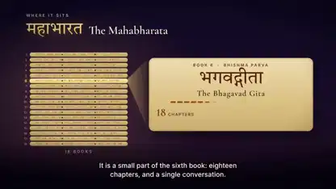

<!-- Generated by scripts/build.py. -->

# An Animated Reading of the Bhagavad Gita

[Back to collection](https://github.com/VibeClip/awesome-fable-5-2-videos/blob/main/README.md)

**[▶ Watch](https://video.twimg.com/amplify_video/2122094774819889152/vid/avc1/1920x1080/TFDaqmQklxyNq6UJ.mp4?tag=29)** · [Original post](https://x.com/YashVrdn/status/2122094907179610234)

[YashVrdn](https://x.com/YashVrdn) · 5:10 · 2026-11-15

The author credits Fable 5.2 for the adaptation. The post leaves the renderer and asset sources unspecified.

## Shared prompt

No public prompt recorded.

Sources & verification

- Model evidence: Model named in original post
- Post availability checked: 2026-11-16 — Post available

Source availability and video generation are separate checks. Generation and rendering were not independently reproduced.

[License & media rights](https://github.com/VibeClip/awesome-fable-5-2-videos/blob/main/docs/MEDIA-RIGHTS.md)

