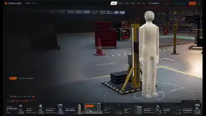

<!-- Generated by scripts/build.py. -->

# Un hangar virtual para explorar el montaje de robots

[Volver a la colección](https://github.com/VibeClip/awesome-fable-5-2-videos/blob/main/README.es.md)

**[▶ Ver vídeo](https://video.twimg.com/amplify_video/2120526618925899776/vid/avc1/3596x2084/5KVxtJ0HMeLJ5swp.mp4?tag=29)** · [Publicación original](https://x.com/0xMovez/status/2120526918621515872)

[0xMovez](https://x.com/0xMovez) · 1:34 · 2026-11-11

El autor afirma que Fable 5.2 generó por código los modelos 3D de robots para una demostración educativa interactiva.

## Prompt compartido

No hay un prompt público registrado.

Fuentes y comprobaciones

- Evidencia del modelo: El modelo se menciona en la publicación original
- Accesibilidad de la publicación comprobada: 2026-11-13 — Publicación accesible

Comprobar el acceso a una publicación no equivale a reproducir su generación. La generación y el renderizado no se reprodujeron de forma independiente.

[Licencia y derechos del contenido](https://github.com/VibeClip/awesome-fable-5-2-videos/blob/main/docs/MEDIA-RIGHTS.md)

