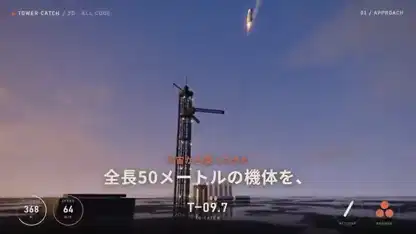

<!-- Generated by scripts/build.py. -->

# Una recreación animada de la captura de Starship

[Volver a la colección](https://github.com/VibeClip/awesome-fable-5-2-videos/blob/main/README.es.md)

**[▶ Ver vídeo](https://video.twimg.com/amplify_video/2121868165789671424/vid/avc1/1920x1080/xtuXt7hB_shJ9Rr2.mp4?tag=29)** · [Publicación original](https://x.com/29meat_ai/status/2121884408202617155)

[29meat_ai](https://x.com/29meat_ai) · 0:30 · 2026-11-15

El autor atribuye a Fable 5.2 la recreación del evento mediante código. El vídeo alterna una vista general de la torre y un esquema anotado de la captura.

## Prompt compartido

No hay un prompt público registrado.

Fuentes y comprobaciones

- Evidencia del modelo: El modelo se menciona en la publicación original
- Accesibilidad de la publicación comprobada: 2026-11-15 — Publicación accesible

Comprobar el acceso a una publicación no equivale a reproducir su generación. La generación y el renderizado no se reprodujeron de forma independiente.

[Licencia y derechos del contenido](https://github.com/VibeClip/awesome-fable-5-2-videos/blob/main/docs/MEDIA-RIGHTS.md)

