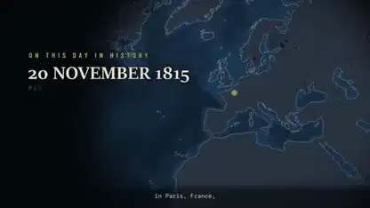

<!-- Generated by scripts/build.py. -->

# El segundo Tratado de París

[Volver a la colección](https://github.com/VibeClip/awesome-fable-5-2-videos/blob/main/README.es.md)

**[▶ Ver vídeo](https://video.twimg.com/amplify_video/2121299667233234945/vid/avc1/1920x1080/Fj-__n_Xwic0VA0B.mp4?tag=29)** · [Publicación original](https://x.com/adityavg13/status/2121299920141599107)

[adityavg13](https://x.com/adityavg13) · 1:44 · 2026-11-13

El autor atribuye la edición a Fable 5.2 y After Effects y aporta su propia narración.

## Prompt compartido

No hay un prompt público registrado.

Fuentes y comprobaciones

- Evidencia del modelo: El modelo se menciona en la publicación original
- Accesibilidad de la publicación comprobada: 2026-11-16 — Publicación accesible

Comprobar el acceso a una publicación no equivale a reproducir su generación. La generación y el renderizado no se reprodujeron de forma independiente.

[Licencia y derechos del contenido](https://github.com/VibeClip/awesome-fable-5-2-videos/blob/main/docs/MEDIA-RIGHTS.md)

