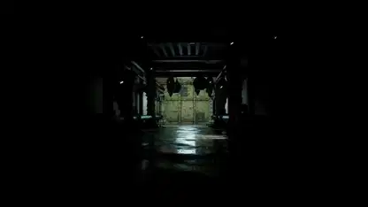

<!-- Generated by scripts/build.py. -->

# La araña de la linterna

[Volver a la colección](https://github.com/VibeClip/awesome-fable-5-2-videos/blob/main/README.es.md)

**[▶ Ver vídeo](https://video.twimg.com/amplify_video/2122065027339329536/vid/avc1/2580x1080/TXi8bpetSDYDKLzz.mp4?tag=29)** · [Publicación original](https://x.com/aGim_asf/status/2122065184743153882)

[aGim_asf](https://x.com/aGim_asf) · 1:03 · 2026-11-15

El autor usó imágenes de GPT y Tripo para los recursos. Fable 5.2 programó el rig, los planos y la animación en Blender. Una respuesta del autor enlaza el proceso completo, el prompt y los créditos de sonido.

[Publicación original](https://x.com/aGim_asf/status/2122065188325122269)

## Prompt compartido

El creador compartió un prompt en el enlace siguiente. Consulta el contexto original, sus referencias y las instrucciones posteriores.

[Leer el prompt del creador](https://x.com/aGim_asf/status/2122065188325122269)

Fuentes y comprobaciones

- Evidencia del modelo: El modelo se menciona en la publicación original
- Accesibilidad de la publicación comprobada: 2026-11-16 — Publicación accesible

Comprobar el acceso a una publicación no equivale a reproducir su generación. La generación y el renderizado no se reprodujeron de forma independiente.

[Licencia y derechos del contenido](https://github.com/VibeClip/awesome-fable-5-2-videos/blob/main/docs/MEDIA-RIGHTS.md)

