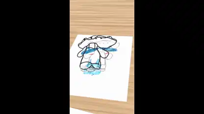

<!-- Generated by scripts/build.py. -->

# Una línea dibujada se vuelve hilo y recompone un personaje

[Volver a la colección](https://github.com/VibeClip/awesome-fable-5-2-videos/blob/main/README.es.md)

**[▶ Ver vídeo](https://video.twimg.com/amplify_video/2121888732135788544/vid/avc1/1080x1920/T6MRHBPf7hXe_aPh.mp4?tag=29)** · [Publicación original](https://x.com/akiyoshisan/status/2121890007237722501)

[akiyoshisan](https://x.com/akiyoshisan) · 1:08 · 2026-11-15

El autor atribuye a Fable 5.2 la extracción de líneas con OpenCV y el renderizado con Python en Blender. La música parte de una grabación de bajo y Suno prolonga una sección.

## Prompt compartido

Texto original compartido por el creador. Consulta la fuente para conocer el contexto y los materiales necesarios.

> 手描きの線そのものを立体にして

[Leer el prompt del creador](https://x.com/akiyoshisan/status/2121890007237722501)

Fuentes y comprobaciones

- Evidencia del modelo: El modelo se menciona en la publicación original
- Accesibilidad de la publicación comprobada: 2026-11-15 — Publicación accesible

Comprobar el acceso a una publicación no equivale a reproducir su generación. La generación y el renderizado no se reprodujeron de forma independiente.

[Licencia y derechos del contenido](https://github.com/VibeClip/awesome-fable-5-2-videos/blob/main/docs/MEDIA-RIGHTS.md)

