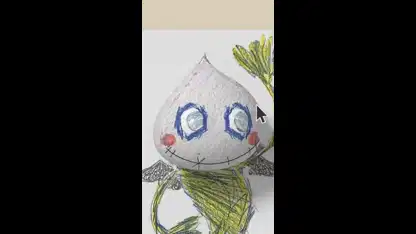

<!-- Generated by scripts/build.py. -->

# El cursor recibe un mordisco

[Volver a la colección](https://github.com/VibeClip/awesome-fable-5-2-videos/blob/main/README.es.md)

**[▶ Ver vídeo](https://video.twimg.com/amplify_video/2123710302386814976/vid/avc1/320x568/hElUVF47HZ87yHTf.mp4?tag=29)** · [Publicación original](https://x.com/akiyoshisan/status/2123710585963692068)

[akiyoshisan](https://x.com/akiyoshisan) · 0:32 · 2026-11-20

Fable 5.2 dirigió nueve dibujos originales con Python y Blender. Suno amplió la grabación de bajo del autor y FFmpeg ensambló los fotogramas.

## Prompt compartido

Texto original compartido por el creador. Consulta la fuente para conocer el contexto y los materiales necesarios.

> 絵が矢印に反応する

[Leer el prompt del creador](https://x.com/akiyoshisan/status/2123710585963692068)

Fuentes y comprobaciones

- Evidencia del modelo: El modelo se menciona en la publicación original
- Accesibilidad de la publicación comprobada: 2026-11-21 — Publicación accesible

Comprobar el acceso a una publicación no equivale a reproducir su generación. La generación y el renderizado no se reprodujeron de forma independiente.

[Licencia y derechos del contenido](https://github.com/VibeClip/awesome-fable-5-2-videos/blob/main/docs/MEDIA-RIGHTS.md)

