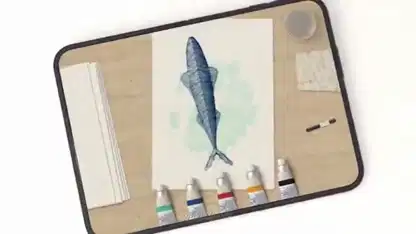

<!-- Generated by scripts/build.py. -->

# Demostración de una app de acuarela para pantalla plegable

[Volver a la colección](https://github.com/VibeClip/awesome-fable-5-2-videos/blob/main/README.es.md)

**[▶ Ver vídeo](https://video.twimg.com/amplify_video/2120301806248984576/vid/avc1/960x540/SPRHR2g2Wawm3bva.mp4?tag=29)** · [Publicación original](https://x.com/anshuc/status/2120301850532499927)

[anshuc](https://x.com/anshuc) · 1:07 · 2026-11-10

El autor encargó a Fable 5.2 crear y grabar una app que usa el ángulo de plegado, aportó herramientas de diseño y vídeo e intervino para revisar el resultado.

[Publicación original](https://x.com/anshuc/status/2120301853825024054)

## Prompt compartido

El creador compartió un prompt en el enlace siguiente. Consulta el contexto original, sus referencias y las instrucciones posteriores.

[Leer el prompt del creador](https://x.com/anshuc/status/2120301853825024054)

Fuentes y comprobaciones

- Evidencia del modelo: El modelo se menciona en la publicación original
- Accesibilidad de la publicación comprobada: 2026-11-16 — Publicación accesible

Comprobar el acceso a una publicación no equivale a reproducir su generación. La generación y el renderizado no se reprodujeron de forma independiente.

[Licencia y derechos del contenido](https://github.com/VibeClip/awesome-fable-5-2-videos/blob/main/docs/MEDIA-RIGHTS.md)

