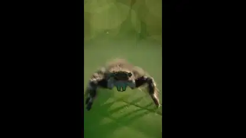

<!-- Generated by scripts/build.py. -->

# Un corto de estilo macro de una araña sobre una hoja

[Volver a la colección](https://github.com/VibeClip/awesome-fable-5-2-videos/blob/main/README.es.md)

**[▶ Ver vídeo](https://video.twimg.com/amplify_video/2120213743829168128/vid/avc1/1080x1920/rJtx59-X2623RSlg.mp4?tag=29)** · [Publicación original](https://x.com/aollivier82/status/2120290412283703522)

[aollivier82](https://x.com/aollivier82) · 0:15 · 2026-11-10

El autor pidió a Fable 5.2 un vídeo fotorrealista de una araña. La poca profundidad de campo y el encuadre a ras de la hoja evocan la fotografía macro. Las herramientas no se especificaron.

## Prompt compartido

No hay un prompt público registrado.

Fuentes y comprobaciones

- Evidencia del modelo: El modelo se menciona en la publicación original
- Accesibilidad de la publicación comprobada: 2026-11-15 — Publicación accesible

Comprobar el acceso a una publicación no equivale a reproducir su generación. La generación y el renderizado no se reprodujeron de forma independiente.

[Licencia y derechos del contenido](https://github.com/VibeClip/awesome-fable-5-2-videos/blob/main/docs/MEDIA-RIGHTS.md)

