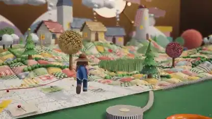

<!-- Generated by scripts/build.py. -->

# Un pueblo de retales jugable con estética de animación fotograma a fotograma

[Volver a la colección](https://github.com/VibeClip/awesome-fable-5-2-videos/blob/main/README.es.md)

**[▶ Ver vídeo](https://video.twimg.com/amplify_video/2120745677055733760/vid/avc1/2560x1440/3alE49tTHiEZV3hx.mp4?tag=29)** · [Publicación original](https://x.com/BlendiByl/status/2120746541636047347)

[BlendiByl](https://x.com/BlendiByl) · 0:27 · 2026-11-12

El autor atribuye la escena jugable a Fable 5.2 e indica que creó todo el mapa mediante código.

## Prompt compartido

No hay un prompt público registrado.

Fuentes y comprobaciones

- Evidencia del modelo: El modelo se menciona en la publicación original
- Accesibilidad de la publicación comprobada: 2026-11-14 — Publicación accesible

Comprobar el acceso a una publicación no equivale a reproducir su generación. La generación y el renderizado no se reprodujeron de forma independiente.

[Licencia y derechos del contenido](https://github.com/VibeClip/awesome-fable-5-2-videos/blob/main/docs/MEDIA-RIGHTS.md)

