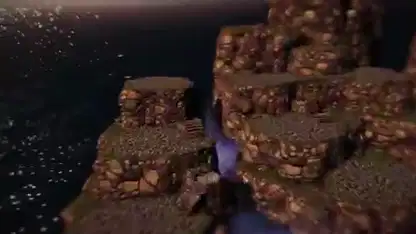

<!-- Generated by scripts/build.py. -->

# Una aldea de píxeles de ensueño

[Volver a la colección](https://github.com/VibeClip/awesome-fable-5-2-videos/blob/main/README.es.md)

**[▶ Ver vídeo](https://video.twimg.com/amplify_video/2123617050056970240/vid/avc1/480x270/DvCi4sP-fsmTKfCr.mp4?tag=29)** · [Publicación original](https://x.com/BlendiByl/status/2123618324823388410)

[BlendiByl](https://x.com/BlendiByl) · 0:29 · 2026-11-20

El autor usó Fable 5.2 para dibujar cada píxel con código y ejecutar la escena en el navegador.

## Prompt compartido

No hay un prompt público registrado.

Fuentes y comprobaciones

- Evidencia del modelo: El modelo se menciona en la publicación original
- Accesibilidad de la publicación comprobada: 2026-11-21 — Publicación accesible

Comprobar el acceso a una publicación no equivale a reproducir su generación. La generación y el renderizado no se reprodujeron de forma independiente.

[Licencia y derechos del contenido](https://github.com/VibeClip/awesome-fable-5-2-videos/blob/main/docs/MEDIA-RIGHTS.md)

