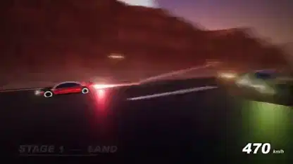

<!-- Generated by scripts/build.py. -->

# Una carrera acrobática de superdeportivos al ritmo de ElevenLabs

[Volver a la colección](https://github.com/VibeClip/awesome-fable-5-2-videos/blob/main/README.es.md)

**[▶ Ver vídeo](https://video.twimg.com/amplify_video/2120135695037837313/vid/avc1/1920x1080/yXrA_ezGd_Frjbvw.mp4?tag=29)** · [Publicación original](https://x.com/challenger_ND/status/2120149476057006186)

[challenger_ND](https://x.com/challenger_ND) · 0:30 · 2026-11-10

El autor pidió a Fable 5.2 una carrera generada con código y sincronizada con una pista de ElevenLabs. Los coches giran en el aire y derrapan en varios escenarios.

## Prompt compartido

No hay un prompt público registrado.

Fuentes y comprobaciones

- Evidencia del modelo: El modelo se menciona en la publicación original
- Accesibilidad de la publicación comprobada: 2026-11-15 — Publicación accesible

Comprobar el acceso a una publicación no equivale a reproducir su generación. La generación y el renderizado no se reprodujeron de forma independiente.

[Licencia y derechos del contenido](https://github.com/VibeClip/awesome-fable-5-2-videos/blob/main/docs/MEDIA-RIGHTS.md)

