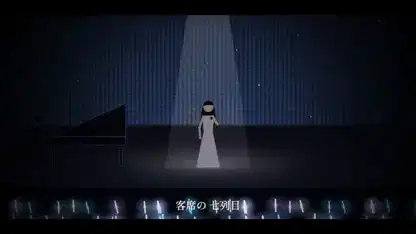

<!-- Generated by scripts/build.py. -->

# El último concierto

[Volver a la colección](https://github.com/VibeClip/awesome-fable-5-2-videos/blob/main/README.es.md)

**[▶ Ver vídeo](https://video.twimg.com/amplify_video/2120422211702177792/vid/avc1/1280x720/s1sR2PVkGpwyUSqy.mp4?tag=29)** · [Publicación original](https://x.com/challenger_ND/status/2120423740756664820)

[challenger_ND](https://x.com/challenger_ND) · 3:02 · 2026-11-11

Es el segundo montaje de la publicación. Fable 5.2 creó la primera versión con código. El autor añadió una pista hecha con Suno y adaptó el montaje a la música.

## Prompt compartido

Texto original compartido por el creador. Consulta la fuente para conocer el contexto y los materiales necesarios.

> 全米が泣けるレベルのライブ動画をコードのみで作って

[Leer el prompt del creador](https://x.com/challenger_ND/status/2120423740756664820)

Fuentes y comprobaciones

- Evidencia del modelo: El modelo se menciona en la publicación original
- Accesibilidad de la publicación comprobada: 2026-11-16 — Publicación accesible

Comprobar el acceso a una publicación no equivale a reproducir su generación. La generación y el renderizado no se reprodujeron de forma independiente.

[Licencia y derechos del contenido](https://github.com/VibeClip/awesome-fable-5-2-videos/blob/main/docs/MEDIA-RIGHTS.md)

