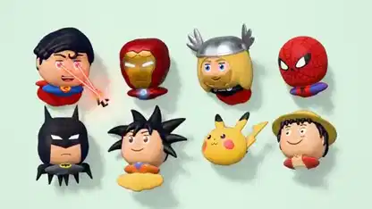

<!-- Generated by scripts/build.py. -->

# Una galería giratoria de personajes de ficción en Three.js

[Volver a la colección](https://github.com/VibeClip/awesome-fable-5-2-videos/blob/main/README.es.md)

**[▶ Ver vídeo](https://video.twimg.com/amplify_video/2120500565855842304/vid/avc1/1920x1080/QIr-yYCmh1SRLnLh.mp4?tag=29)** · [Publicación original](https://x.com/chetaslua/status/2120500937852920144)

[chetaslua](https://x.com/chetaslua) · 0:20 · 2026-11-11

El autor menciona Fable 5.2 y Three.js. Dos filas de cabezas estilizadas giran en el sitio y muestran sus perfiles.

## Prompt compartido

No hay un prompt público registrado.

Fuentes y comprobaciones

- Evidencia del modelo: El modelo se menciona en la publicación original
- Accesibilidad de la publicación comprobada: 2026-11-14 — Publicación accesible

Comprobar el acceso a una publicación no equivale a reproducir su generación. La generación y el renderizado no se reprodujeron de forma independiente.

[Licencia y derechos del contenido](https://github.com/VibeClip/awesome-fable-5-2-videos/blob/main/docs/MEDIA-RIGHTS.md)

