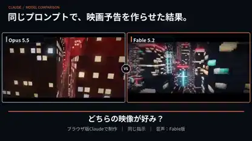

<!-- Generated by scripts/build.py. -->

# Dos modelos montan el tráiler de ciencia ficción La señal final

[Volver a la colección](https://github.com/VibeClip/awesome-fable-5-2-videos/blob/main/README.es.md)

**[▶ Ver vídeo](https://video.twimg.com/amplify_video/2120707203707621378/vid/avc1/1920x1080/phHDECzgrrQ5213D.mp4?tag=29)** · [Publicación original](https://x.com/_creatorzz_/status/2120707230513377714)

[_creatorzz_](https://x.com/_creatorzz_) · 0:20 · 2026-11-12

El autor coloca Opus 5.5 a la izquierda y Fable 5.2 a la derecha. Con la misma instrucción se aprecian diferencias de puesta en escena, cámara y luces de neón. El prompt completo está en la respuesta del autor.

## Prompt compartido

El creador compartió un prompt en el enlace siguiente. Consulta el contexto original, sus referencias y las instrucciones posteriores.

[Leer el prompt del creador](https://x.com/_creatorzz_/status/2120707232824492180)

Fuentes y comprobaciones

- Evidencia del modelo: El modelo se menciona en la publicación original
- Accesibilidad de la publicación comprobada: 2026-11-15 — Publicación accesible

Comprobar el acceso a una publicación no equivale a reproducir su generación. La generación y el renderizado no se reprodujeron de forma independiente.

[Licencia y derechos del contenido](https://github.com/VibeClip/awesome-fable-5-2-videos/blob/main/docs/MEDIA-RIGHTS.md)

