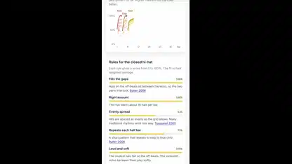

<!-- Generated by scripts/build.py. -->

# Un tema house construido a partir de patrones generados

[Volver a la colección](https://github.com/VibeClip/awesome-fable-5-2-videos/blob/main/README.es.md)

**[▶ Ver vídeo](https://video.twimg.com/amplify_video/2120904570314305536/vid/avc1/1206x2266/8g60h4oMlWzSL0mh.mp4?tag=29)** · [Publicación original](https://x.com/deedydas/status/2120905625852936318)

[deedydas](https://x.com/deedydas) · 5:51 · 2026-11-12

El autor atribuye a Fable 5.2 la prueba de patrones para cada instrumento y su arreglo en una pista house. La grabación original incluye el audio y una vista del arreglo.

[Publicación original](https://x.com/deedydas/status/2120905629459992996)

## Prompt compartido

No hay un prompt público registrado.

Fuentes y comprobaciones

- Evidencia del modelo: El modelo se menciona en la publicación original
- Accesibilidad de la publicación comprobada: 2026-11-15 — Publicación accesible

Comprobar el acceso a una publicación no equivale a reproducir su generación. La generación y el renderizado no se reprodujeron de forma independiente.

[Licencia y derechos del contenido](https://github.com/VibeClip/awesome-fable-5-2-videos/blob/main/docs/MEDIA-RIGHTS.md)

