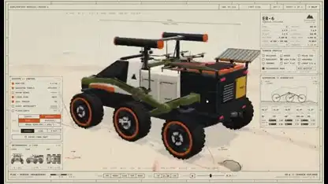

<!-- Generated by scripts/build.py. -->

# Un simulador de suspensión de un róver para terreno irregular

[Volver a la colección](https://github.com/VibeClip/awesome-fable-5-2-videos/blob/main/README.es.md)

**[▶ Ver vídeo](https://video.twimg.com/amplify_video/2120558575387131905/vid/avc1/3456x1990/D5saQ1Xn1-2_bXLA.mp4?tag=29)** · [Publicación original](https://x.com/DilumSanjaya/status/2120561077385867663)

[DilumSanjaya](https://x.com/DilumSanjaya) · 1:22 · 2026-11-11

El autor pidió a Fable 5.2 diseñar un vehículo con suspensión rocker-bogie y simular la conducción en terreno irregular. El vídeo muestra el movimiento de las ruedas desde varios ángulos. La publicación enlaza la versión interactiva.

## Prompt compartido

No hay un prompt público registrado.

Fuentes y comprobaciones

- Evidencia del modelo: El modelo se menciona en la publicación original
- Accesibilidad de la publicación comprobada: 2026-11-14 — Publicación accesible

Comprobar el acceso a una publicación no equivale a reproducir su generación. La generación y el renderizado no se reprodujeron de forma independiente.

[Licencia y derechos del contenido](https://github.com/VibeClip/awesome-fable-5-2-videos/blob/main/docs/MEDIA-RIGHTS.md)

