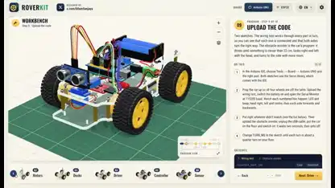

<!-- Generated by scripts/build.py. -->

# RoverKit, una guía interactiva para montar un robot

[Volver a la colección](https://github.com/VibeClip/awesome-fable-5-2-videos/blob/main/README.es.md)

**[▶ Ver vídeo](https://video.twimg.com/amplify_video/2121283445456588800/vid/avc1/3456x1990/uBZhtusJ-gGu4i86.mp4?tag=29)** · [Publicación original](https://x.com/DilumSanjaya/status/2121286147393651085)

[DilumSanjaya](https://x.com/DilumSanjaya) · 1:46 · 2026-11-13

El autor atribuye la aplicación a Fable 5.2. La demostración pasa de una guía de montaje en 3D a una explicación visual del código y un simulador de conducción con pista configurable.

[Publicación original](https://x.com/DilumSanjaya/status/2121286149910220854)

## Prompt compartido

No hay un prompt público registrado.

Fuentes y comprobaciones

- Evidencia del modelo: El modelo se menciona en la publicación original
- Accesibilidad de la publicación comprobada: 2026-11-14 — Publicación accesible

Comprobar el acceso a una publicación no equivale a reproducir su generación. La generación y el renderizado no se reprodujeron de forma independiente.

[Licencia y derechos del contenido](https://github.com/VibeClip/awesome-fable-5-2-videos/blob/main/docs/MEDIA-RIGHTS.md)

