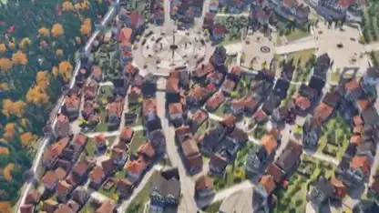

<!-- Generated by scripts/build.py. -->

# Una ciudad en 3D desde los tejados hasta la calle

[Volver a la colección](https://github.com/VibeClip/awesome-fable-5-2-videos/blob/main/README.es.md)

**[▶ Ver vídeo](https://video.twimg.com/amplify_video/2120059143515987968/vid/avc1/2560x1440/T0fkZZHKry2zwcnM.mp4?tag=29)** · [Publicación original](https://x.com/eluchocha/status/2120059951485698350)

[eluchocha](https://x.com/eluchocha) · 0:59 · 2026-11-10

El autor atribuye la ciudad a Fable 5.2 y dice que los recursos se hicieron en Blender. El vídeo empieza sobre los tejados y termina a pie de calle.

## Prompt compartido

No hay un prompt público registrado.

Fuentes y comprobaciones

- Evidencia del modelo: El modelo se menciona en la publicación original
- Accesibilidad de la publicación comprobada: 2026-11-14 — Publicación accesible

Comprobar el acceso a una publicación no equivale a reproducir su generación. La generación y el renderizado no se reprodujeron de forma independiente.

[Licencia y derechos del contenido](https://github.com/VibeClip/awesome-fable-5-2-videos/blob/main/docs/MEDIA-RIGHTS.md)

