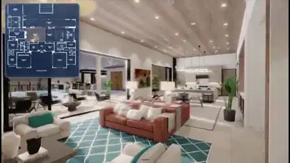

<!-- Generated by scripts/build.py. -->

# De un plano a un recorrido por una vivienda amueblada

[Volver a la colección](https://github.com/VibeClip/awesome-fable-5-2-videos/blob/main/README.es.md)

**[▶ Ver vídeo](https://video.twimg.com/amplify_video/2120175906501345281/vid/avc1/1902x1080/bf_XglfsEta4QCXA.mp4?tag=16)** · [Publicación original](https://x.com/everestchris6/status/2120175941616128277)

[everestchris6](https://x.com/everestchris6) · 0:10 · 2026-11-10

El autor atribuye a Fable 5.2 la conversión de un plano en un recorrido 3D. El plano queda en una esquina mientras la cámara atraviesa las habitaciones amuebladas.

## Prompt compartido

No hay un prompt público registrado.

Fuentes y comprobaciones

- Evidencia del modelo: El modelo se menciona en la publicación original
- Accesibilidad de la publicación comprobada: 2026-11-15 — Publicación accesible

Comprobar el acceso a una publicación no equivale a reproducir su generación. La generación y el renderizado no se reprodujeron de forma independiente.

[Licencia y derechos del contenido](https://github.com/VibeClip/awesome-fable-5-2-videos/blob/main/docs/MEDIA-RIGHTS.md)

