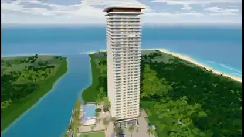

<!-- Generated by scripts/build.py. -->

# Un recorrido en Three.js del exterior de una torre al apartamento

[Volver a la colección](https://github.com/VibeClip/awesome-fable-5-2-videos/blob/main/README.es.md)

**[▶ Ver vídeo](https://video.twimg.com/amplify_video/2120939561715163137/vid/avc1/1898x1080/jxemZtOQ1szTzU7-.mp4?tag=16)** · [Publicación original](https://x.com/everestchris6/status/2120939600504074444)

[everestchris6](https://x.com/everestchris6) · 0:16 · 2026-11-12

El autor menciona Fable 5.2 y Three.js para el recorrido. El vídeo muestra primero la torre rodeada de agua y después un apartamento con un ventanal curvo.

## Prompt compartido

No hay un prompt público registrado.

Fuentes y comprobaciones

- Evidencia del modelo: El modelo se menciona en la publicación original
- Accesibilidad de la publicación comprobada: 2026-11-15 — Publicación accesible

Comprobar el acceso a una publicación no equivale a reproducir su generación. La generación y el renderizado no se reprodujeron de forma independiente.

[Licencia y derechos del contenido](https://github.com/VibeClip/awesome-fable-5-2-videos/blob/main/docs/MEDIA-RIGHTS.md)

