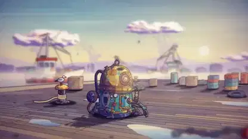

<!-- Generated by scripts/build.py. -->

# Un robot oxidado junto al agua

[Volver a la colección](https://github.com/VibeClip/awesome-fable-5-2-videos/blob/main/README.es.md)

**[▶ Ver vídeo](https://video.twimg.com/amplify_video/2120993122905714688/vid/avc1/1920x1080/YvGH-b768C4qpAkk.mp4?tag=29)** · [Publicación original](https://x.com/finnardley/status/2120993184561995884)

[finnardley](https://x.com/finnardley) · 0:14 · 2026-11-12

El autor dibujó las imágenes con Canvas y JavaScript en un único archivo HTML, renderizó los fotogramas con Playwright y montó el vídeo con FFmpeg.

## Prompt compartido

No hay un prompt público registrado.

Fuentes y comprobaciones

- Evidencia del modelo: El modelo se menciona en la publicación original
- Accesibilidad de la publicación comprobada: 2026-11-16 — Publicación accesible

Comprobar el acceso a una publicación no equivale a reproducir su generación. La generación y el renderizado no se reprodujeron de forma independiente.

[Licencia y derechos del contenido](https://github.com/VibeClip/awesome-fable-5-2-videos/blob/main/docs/MEDIA-RIGHTS.md)

