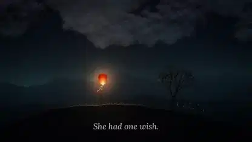

<!-- Generated by scripts/build.py. -->

# Un deseo en la noche

[Volver a la colección](https://github.com/VibeClip/awesome-fable-5-2-videos/blob/main/README.es.md)

**[▶ Ver vídeo](https://video.twimg.com/amplify_video/2121360344727609344/vid/avc1/1280x720/4oNmqpcE1pO7yUPp.mp4?tag=14)** · [Publicación original](https://x.com/GabransKristers/status/2121361595313828070)

[GabransKristers](https://x.com/GabransKristers) · 0:20 · 2026-11-13

El autor atribuye a Fable 5.2 la historia, los fotogramas dibujados con código y el sonido.

## Prompt compartido

No hay un prompt público registrado.

Fuentes y comprobaciones

- Evidencia del modelo: El modelo se menciona en la publicación original
- Accesibilidad de la publicación comprobada: 2026-11-16 — Publicación accesible

Comprobar el acceso a una publicación no equivale a reproducir su generación. La generación y el renderizado no se reprodujeron de forma independiente.

[Licencia y derechos del contenido](https://github.com/VibeClip/awesome-fable-5-2-videos/blob/main/docs/MEDIA-RIGHTS.md)

