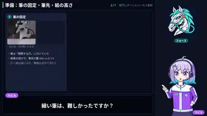

<!-- Generated by scripts/build.py. -->

# Una explicación ilustrada de cómo un robot dibujó Kaminarimon

[Volver a la colección](https://github.com/VibeClip/awesome-fable-5-2-videos/blob/main/README.es.md)

**[▶ Ver vídeo](https://video.twimg.com/amplify_video/2121494558106439680/vid/avc1/1920x1080/DPZRyASdC9HYAryE.mp4?tag=29)** · [Publicación original](https://x.com/gclue_akira/status/2121494801506050378)

[gclue_akira](https://x.com/gclue_akira) · 2:06 · 2026-11-14

El autor explica el proceso de dibujo de Kaminarimon con Fable 5.2 y Tazuna Robotics Harness. El vídeo incluye un personaje narrador y capturas de las distintas etapas. El autor no especificó cómo se renderizó el propio vídeo explicativo.

## Prompt compartido

No hay un prompt público registrado.

Fuentes y comprobaciones

- Evidencia del modelo: El modelo se menciona en la publicación original
- Accesibilidad de la publicación comprobada: 2026-11-14 — Publicación accesible

Comprobar el acceso a una publicación no equivale a reproducir su generación. La generación y el renderizado no se reprodujeron de forma independiente.

[Licencia y derechos del contenido](https://github.com/VibeClip/awesome-fable-5-2-videos/blob/main/docs/MEDIA-RIGHTS.md)

