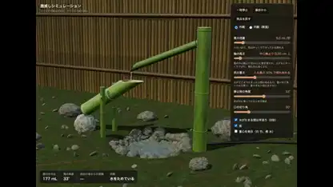

<!-- Generated by scripts/build.py. -->

# Un shishi-odoshi de bambú en 3D

[Volver a la colección](https://github.com/VibeClip/awesome-fable-5-2-videos/blob/main/README.es.md)

**[▶ Ver vídeo](https://video.twimg.com/amplify_video/2121960705310232576/vid/avc1/2400x1720/ats5frt2FrWmPy0S.mp4?tag=29)** · [Publicación original](https://x.com/gengo6com/status/2121960819244372252)

[gengo6com](https://x.com/gengo6com) · 0:14 · 2026-11-15

El autor atribuye a Fable 5.2 la versión revisada del shishi-odoshi. La publicación no especifica el motor de renderizado.

## Prompt compartido

No hay un prompt público registrado.

Fuentes y comprobaciones

- Evidencia del modelo: El modelo se menciona en la publicación original
- Accesibilidad de la publicación comprobada: 2026-11-16 — Publicación accesible

Comprobar el acceso a una publicación no equivale a reproducir su generación. La generación y el renderizado no se reprodujeron de forma independiente.

[Licencia y derechos del contenido](https://github.com/VibeClip/awesome-fable-5-2-videos/blob/main/docs/MEDIA-RIGHTS.md)

