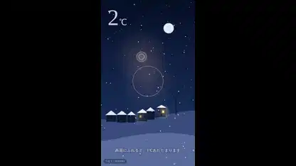

<!-- Generated by scripts/build.py. -->

# Un grado con cada toque

[Volver a la colección](https://github.com/VibeClip/awesome-fable-5-2-videos/blob/main/README.es.md)

**[▶ Ver vídeo](https://video.twimg.com/amplify_video/2120848357682012160/vid/avc1/1080x1920/JsGhsovXasT34cRn.mp4?tag=29)** · [Publicación original](https://x.com/hiromi_sound/status/2120848396315672592)

[hiromi_sound](https://x.com/hiromi_sound) · 0:15 · 2026-11-12

El autor explica que creó la pieza con código usando Fable 5.2, sin importar archivos de imagen ni de audio.

## Prompt compartido

No hay un prompt público registrado.

Fuentes y comprobaciones

- Evidencia del modelo: El modelo se menciona en la publicación original
- Accesibilidad de la publicación comprobada: 2026-11-16 — Publicación accesible

Comprobar el acceso a una publicación no equivale a reproducir su generación. La generación y el renderizado no se reprodujeron de forma independiente.

[Licencia y derechos del contenido](https://github.com/VibeClip/awesome-fable-5-2-videos/blob/main/docs/MEDIA-RIGHTS.md)

