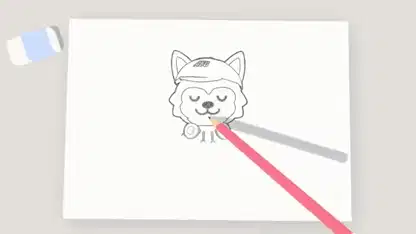

<!-- Generated by scripts/build.py. -->

# Una intro 3D en la que un lobo dibujado cobra vida

[Volver a la colección](https://github.com/VibeClip/awesome-fable-5-2-videos/blob/main/README.es.md)

**[▶ Ver vídeo](https://video.twimg.com/amplify_video/2120622616344219648/vid/avc1/1920x1080/YQkggnwdUXqipVTR.mp4?tag=16)** · [Publicación original](https://x.com/husky__create/status/2120622644362199182)

[husky__create](https://x.com/husky__create) · 0:10 · 2026-11-11

El autor indica que creó la intro con Fable 5.2 y Three.js.

## Prompt compartido

No hay un prompt público registrado.

Fuentes y comprobaciones

- Evidencia del modelo: El modelo se menciona en la publicación original
- Accesibilidad de la publicación comprobada: 2026-11-13 — Publicación accesible

Comprobar el acceso a una publicación no equivale a reproducir su generación. La generación y el renderizado no se reprodujeron de forma independiente.

[Licencia y derechos del contenido](https://github.com/VibeClip/awesome-fable-5-2-videos/blob/main/docs/MEDIA-RIGHTS.md)

