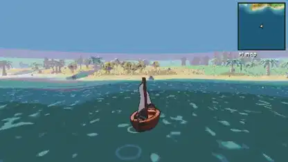

<!-- Generated by scripts/build.py. -->

# Una demo de un juego insular con nuevas animaciones de combate

[Volver a la colección](https://github.com/VibeClip/awesome-fable-5-2-videos/blob/main/README.es.md)

**[▶ Ver vídeo](https://video.twimg.com/amplify_video/2120339686040158208/vid/avc1/1920x1080/-d4odGYaB3R0mUbK.mp4?tag=29)** · [Publicación original](https://x.com/hyphenholdings/status/2120340122461753345)

[hyphenholdings](https://x.com/hyphenholdings) · 1:05 · 2026-11-11

El autor atribuye a Fable 5.2 los movimientos de combate añadidos, incluidas las esquivas y las combinaciones. La grabación también muestra el paso del agua a la isla. El autor enlaza una versión jugable en una respuesta.

[Publicación original](https://x.com/hyphenholdings/status/2120340296504643866)

## Prompt compartido

No hay un prompt público registrado.

Fuentes y comprobaciones

- Evidencia del modelo: El modelo se menciona en la publicación original
- Accesibilidad de la publicación comprobada: 2026-11-15 — Publicación accesible

Comprobar el acceso a una publicación no equivale a reproducir su generación. La generación y el renderizado no se reprodujeron de forma independiente.

[Licencia y derechos del contenido](https://github.com/VibeClip/awesome-fable-5-2-videos/blob/main/docs/MEDIA-RIGHTS.md)

