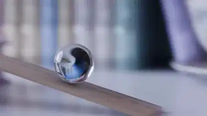

<!-- Generated by scripts/build.py. -->

# Una pequeña sala de té en bucle hecha en Blender

[Volver a la colección](https://github.com/VibeClip/awesome-fable-5-2-videos/blob/main/README.es.md)

**[▶ Ver vídeo](https://video.twimg.com/amplify_video/2120311299917873153/vid/avc1/1280x720/XX6AfZsYEyGyUmg8.mp4?tag=29)** · [Publicación original](https://x.com/ICO_AIvideo/status/2120311646933680355)

[ICO_AIvideo](https://x.com/ICO_AIvideo) · 0:22 · 2026-11-11

El autor menciona Fable 5.2 y Blender. La cámara pasa junto a la porcelana y una esfera reflectante antes de revelar la sala rosa.

## Prompt compartido

No hay un prompt público registrado.

Fuentes y comprobaciones

- Evidencia del modelo: El modelo se menciona en la publicación original
- Accesibilidad de la publicación comprobada: 2026-11-15 — Publicación accesible

Comprobar el acceso a una publicación no equivale a reproducir su generación. La generación y el renderizado no se reprodujeron de forma independiente.

[Licencia y derechos del contenido](https://github.com/VibeClip/awesome-fable-5-2-videos/blob/main/docs/MEDIA-RIGHTS.md)

