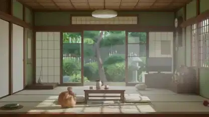

<!-- Generated by scripts/build.py. -->

# Un perro pequeño en una sala de tatami iluminada por el sol

[Volver a la colección](https://github.com/VibeClip/awesome-fable-5-2-videos/blob/main/README.es.md)

**[▶ Ver vídeo](https://video.twimg.com/amplify_video/2120858849347567616/vid/avc1/1920x1080/nn3mPUMUshjI7UNO.mp4?tag=29)** · [Publicación original](https://x.com/ICO_AIvideo/status/2120860567581921508)

[ICO_AIvideo](https://x.com/ICO_AIvideo) · 0:20 · 2026-11-12

El autor dice que Fable 5.2 construyó la sala y animó al perro en Blender a partir de imágenes de referencia. El vídeo sigue al perro entre manchas de sol sobre el suelo.

## Prompt compartido

No hay un prompt público registrado.

Fuentes y comprobaciones

- Evidencia del modelo: El modelo se menciona en la publicación original
- Accesibilidad de la publicación comprobada: 2026-11-15 — Publicación accesible

Comprobar el acceso a una publicación no equivale a reproducir su generación. La generación y el renderizado no se reprodujeron de forma independiente.

[Licencia y derechos del contenido](https://github.com/VibeClip/awesome-fable-5-2-videos/blob/main/docs/MEDIA-RIGHTS.md)

