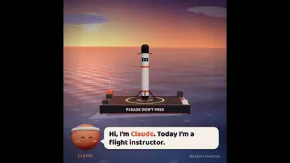

<!-- Generated by scripts/build.py. -->

# Una IA aprende a aterrizar un cohete

[Volver a la colección](https://github.com/VibeClip/awesome-fable-5-2-videos/blob/main/README.es.md)

**[▶ Ver vídeo](https://video.twimg.com/amplify_video/2121065917526298624/vid/avc1/1080x1080/_fK2vPkd7B9dTr6U.mp4?tag=29)** · [Publicación original](https://x.com/imjustnewatai/status/2121066003123847611)

[imjustnewatai](https://x.com/imjustnewatai) · 1:32 · 2026-11-13

El autor pidió a Fable 5.2 que enseñara a una IA a aterrizar un cohete. El vídeo muestra intentos simulados sucesivos con contadores en pantalla. El autor no especificó las herramientas de renderizado.

## Prompt compartido

No hay un prompt público registrado.

Fuentes y comprobaciones

- Evidencia del modelo: El modelo se menciona en la publicación original
- Accesibilidad de la publicación comprobada: 2026-11-14 — Publicación accesible

Comprobar el acceso a una publicación no equivale a reproducir su generación. La generación y el renderizado no se reprodujeron de forma independiente.

[Licencia y derechos del contenido](https://github.com/VibeClip/awesome-fable-5-2-videos/blob/main/docs/MEDIA-RIGHTS.md)

