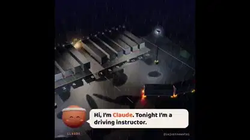

<!-- Generated by scripts/build.py. -->

# Aprender a dar marcha atrás con dos remolques

[Volver a la colección](https://github.com/VibeClip/awesome-fable-5-2-videos/blob/main/README.es.md)

**[▶ Ver vídeo](https://video.twimg.com/amplify_video/2121097408348078080/vid/avc1/1080x1080/pItof1FZpm6_WoHd.mp4?tag=29)** · [Publicación original](https://x.com/imjustnewatai/status/2121097470373511184)

[imjustnewatai](https://x.com/imjustnewatai) · 1:32 · 2026-11-13

El autor usó Fable 5.2 para simular cómo un agente aprende a estacionar marcha atrás un camión con dos remolques en un espacio estrecho.

## Prompt compartido

No hay un prompt público registrado.

Fuentes y comprobaciones

- Evidencia del modelo: El modelo se menciona en la publicación original
- Accesibilidad de la publicación comprobada: 2026-11-13 — Publicación accesible

Comprobar el acceso a una publicación no equivale a reproducir su generación. La generación y el renderizado no se reprodujeron de forma independiente.

[Licencia y derechos del contenido](https://github.com/VibeClip/awesome-fable-5-2-videos/blob/main/docs/MEDIA-RIGHTS.md)

