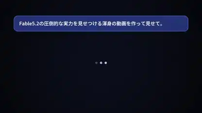

<!-- Generated by scripts/build.py. -->

# Una presentación de Fable renderizada con código

[Volver a la colección](https://github.com/VibeClip/awesome-fable-5-2-videos/blob/main/README.es.md)

**[▶ Ver vídeo](https://video.twimg.com/amplify_video/2120377027459182593/vid/avc1/1920x1080/RslvkhvTk3_XDi4c.mp4?tag=29)** · [Publicación original](https://x.com/jjjContinue/status/2120435611391909934)

[jjjContinue](https://x.com/jjjContinue) · 0:45 · 2026-11-11

El autor atribuye la pieza a Fable 5.2. Pasa de una apertura que simula un chat a formas luminosas, contadores y tipografía japonesa de gran tamaño.

[Publicación original](https://x.com/jjjContinue/status/2120097601601372353)

## Prompt compartido

No hay un prompt público registrado.

Fuentes y comprobaciones

- Evidencia del modelo: El modelo se menciona en la publicación original
- Accesibilidad de la publicación comprobada: 2026-11-14 — Publicación accesible

Comprobar el acceso a una publicación no equivale a reproducir su generación. La generación y el renderizado no se reprodujeron de forma independiente.

[Licencia y derechos del contenido](https://github.com/VibeClip/awesome-fable-5-2-videos/blob/main/docs/MEDIA-RIGHTS.md)

