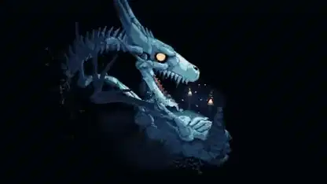

<!-- Generated by scripts/build.py. -->

# Gaussian splats en pixel art: faroles y criaturas

[Volver a la colección](https://github.com/VibeClip/awesome-fable-5-2-videos/blob/main/README.es.md)

**[▶ Ver vídeo](https://video.twimg.com/amplify_video/2121782187787948033/vid/avc1/1920x1080/K-68absx2B7a3ZFC.mp4?tag=29)** · [Publicación original](https://x.com/JungleSilicon/status/2121782359901212987)

[JungleSilicon](https://x.com/JungleSilicon) · 0:36 · 2026-11-15

El autor atribuye la pieza a Fable 5.2 e identifica la técnica visual como Gaussian splats de estilo pixel art.

[Publicación original](https://x.com/JungleSilicon/status/2122245399746637972)

## Prompt compartido

No hay un prompt público registrado.

Fuentes y comprobaciones

- Evidencia del modelo: El modelo se menciona en la publicación original
- Accesibilidad de la publicación comprobada: 2026-11-16 — Publicación accesible

Comprobar el acceso a una publicación no equivale a reproducir su generación. La generación y el renderizado no se reprodujeron de forma independiente.

[Licencia y derechos del contenido](https://github.com/VibeClip/awesome-fable-5-2-videos/blob/main/docs/MEDIA-RIGHTS.md)

