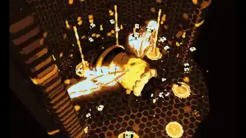

<!-- Generated by scripts/build.py. -->

# Dioramas luminosos con Gaussian splats en pixel art

[Volver a la colección](https://github.com/VibeClip/awesome-fable-5-2-videos/blob/main/README.es.md)

**[▶ Ver vídeo](https://video.twimg.com/amplify_video/2121893301498548225/vid/avc1/2684x1634/BjcN6u6IjQ3NdAI7.mp4?tag=29)** · [Publicación original](https://x.com/JungleSilicon/status/2121893902286524880)

[JungleSilicon](https://x.com/JungleSilicon) · 0:38 · 2026-11-15

El autor describe la pieza como Gaussian splats de estilo pixel art hechos con Fable 5.2.

[Publicación original](https://x.com/JungleSilicon/status/2122245541593751844)

## Prompt compartido

No hay un prompt público registrado.

Fuentes y comprobaciones

- Evidencia del modelo: El modelo se menciona en la publicación original
- Accesibilidad de la publicación comprobada: 2026-11-16 — Publicación accesible

Comprobar el acceso a una publicación no equivale a reproducir su generación. La generación y el renderizado no se reprodujeron de forma independiente.

[Licencia y derechos del contenido](https://github.com/VibeClip/awesome-fable-5-2-videos/blob/main/docs/MEDIA-RIGHTS.md)

