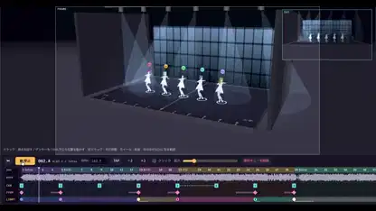

<!-- Generated by scripts/build.py. -->

# Un escenario 3D de previsualización para coreografías

[Volver a la colección](https://github.com/VibeClip/awesome-fable-5-2-videos/blob/main/README.es.md)

**[▶ Ver vídeo](https://video.twimg.com/amplify_video/2120148511836835840/vid/avc1/2830x1496/qlQkuQ7RRb6l2keO.mp4?tag=29)** · [Publicación original](https://x.com/keiru_ai/status/2120148813142958454)

[keiru_ai](https://x.com/keiru_ai) · 0:54 · 2026-11-10

El autor cita Fable 5.2, Claude Code y Suno para el prototipo, y dice que permite importar personajes VRM y movimientos FBX de Mixamo.

## Prompt compartido

No hay un prompt público registrado.

Fuentes y comprobaciones

- Evidencia del modelo: El modelo se menciona en la publicación original
- Accesibilidad de la publicación comprobada: 2026-11-13 — Publicación accesible

Comprobar el acceso a una publicación no equivale a reproducir su generación. La generación y el renderizado no se reprodujeron de forma independiente.

[Licencia y derechos del contenido](https://github.com/VibeClip/awesome-fable-5-2-videos/blob/main/docs/MEDIA-RIGHTS.md)

