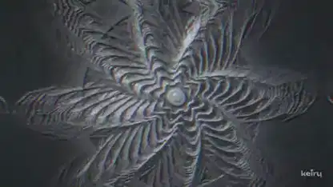

<!-- Generated by scripts/build.py. -->

# Drum and bass industrial con semilla aleatoria y visuales en relieve

[Volver a la colección](https://github.com/VibeClip/awesome-fable-5-2-videos/blob/main/README.es.md)

**[▶ Ver vídeo](https://video.twimg.com/amplify_video/2120532142832934912/vid/avc1/1920x1080/pRXtEmq3PKIg5qOf.mp4?tag=29)** · [Publicación original](https://x.com/keiru_ai/status/2120532609625424195)

[keiru_ai](https://x.com/keiru_ai) · 1:36 · 2026-11-11

El autor cita Fable 5.2 en Claude Code, generación de audio con semilla aleatoria y una escena en Three.js.

## Prompt compartido

No hay un prompt público registrado.

Fuentes y comprobaciones

- Evidencia del modelo: El modelo se menciona en la publicación original
- Accesibilidad de la publicación comprobada: 2026-11-13 — Publicación accesible

Comprobar el acceso a una publicación no equivale a reproducir su generación. La generación y el renderizado no se reprodujeron de forma independiente.

[Licencia y derechos del contenido](https://github.com/VibeClip/awesome-fable-5-2-videos/blob/main/docs/MEDIA-RIGHTS.md)

