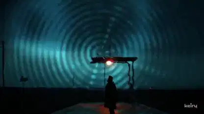

<!-- Generated by scripts/build.py. -->

# Low End Heart, un videoclip de dream pop y drum and bass

[Volver a la colección](https://github.com/VibeClip/awesome-fable-5-2-videos/blob/main/README.es.md)

**[▶ Ver vídeo](https://video.twimg.com/amplify_video/2120895579266207744/vid/avc1/1920x1080/kIxFcuWQm186EBjK.mp4?tag=29)** · [Publicación original](https://x.com/keiru_ai/status/2120896365828173898)

[keiru_ai](https://x.com/keiru_ai) · 3:31 · 2026-11-12

El autor atribuye el montaje a Fable 5.2 en Claude Code, la música a Suno, las imágenes a Midjourney y los efectos visuales a Three.js.

## Prompt compartido

No hay un prompt público registrado.

Fuentes y comprobaciones

- Evidencia del modelo: El modelo se menciona en la publicación original
- Accesibilidad de la publicación comprobada: 2026-11-13 — Publicación accesible

Comprobar el acceso a una publicación no equivale a reproducir su generación. La generación y el renderizado no se reprodujeron de forma independiente.

[Licencia y derechos del contenido](https://github.com/VibeClip/awesome-fable-5-2-videos/blob/main/docs/MEDIA-RIGHTS.md)

