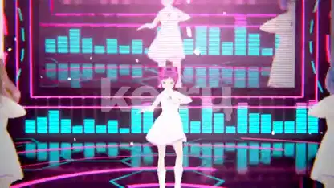

<!-- Generated by scripts/build.py. -->

# Una coreografía de Blender sobre un escenario de neón

[Volver a la colección](https://github.com/VibeClip/awesome-fable-5-2-videos/blob/main/README.es.md)

**[▶ Ver vídeo](https://video.twimg.com/amplify_video/2121273449842962432/vid/avc1/960x540/0Hxd6EBc-ujB6pg3.mp4?tag=29)** · [Publicación original](https://x.com/keiru_ai/status/2121273483950989633)

[keiru_ai](https://x.com/keiru_ai) · 0:24 · 2026-11-13

El autor conectó Claude Code a Blender mediante MCP para automatizar el escenario, las cámaras, la coreografía y la exportación. Atribuye el montaje a Fable 5.2 y la música a Suno.

## Prompt compartido

No hay un prompt público registrado.

Fuentes y comprobaciones

- Evidencia del modelo: El modelo se menciona en la publicación original
- Accesibilidad de la publicación comprobada: 2026-11-14 — Publicación accesible

Comprobar el acceso a una publicación no equivale a reproducir su generación. La generación y el renderizado no se reprodujeron de forma independiente.

[Licencia y derechos del contenido](https://github.com/VibeClip/awesome-fable-5-2-videos/blob/main/docs/MEDIA-RIGHTS.md)

