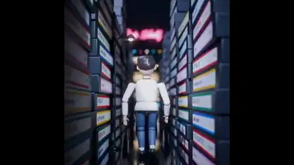

<!-- Generated by scripts/build.py. -->

# Un videoclip de estilo ochentero animado en Blender

[Volver a la colección](https://github.com/VibeClip/awesome-fable-5-2-videos/blob/main/README.es.md)

**[▶ Ver vídeo](https://video.twimg.com/amplify_video/2120947367142981632/vid/avc1/2160x2160/JErOSxM1cooLCIA5.mp4?tag=29)** · [Publicación original](https://x.com/kevin_t_ngo/status/2120948511038648596)

[kevin_t_ngo](https://x.com/kevin_t_ngo) · 2:18 · 2026-11-12

El autor afirma que Fable 5.2 creó las imágenes mediante código, con animación en Python y renderizado en Blender.

## Prompt compartido

No hay un prompt público registrado.

Fuentes y comprobaciones

- Evidencia del modelo: El modelo se menciona en la publicación original
- Accesibilidad de la publicación comprobada: 2026-11-13 — Publicación accesible

Comprobar el acceso a una publicación no equivale a reproducir su generación. La generación y el renderizado no se reprodujeron de forma independiente.

[Licencia y derechos del contenido](https://github.com/VibeClip/awesome-fable-5-2-videos/blob/main/docs/MEDIA-RIGHTS.md)

