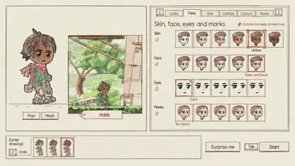

<!-- Generated by scripts/build.py. -->

# Valsera, un RPG de desplazamiento lateral dibujado con código

[Volver a la colección](https://github.com/VibeClip/awesome-fable-5-2-videos/blob/main/README.es.md)

**[▶ Ver vídeo](https://video.twimg.com/amplify_video/2121679674543890432/vid/avc1/1920x1080/BOfROoc3Hogm0aWs.mp4?tag=29)** · [Publicación original](https://x.com/kevin_t_ngo/status/2121701020598415465)

[kevin_t_ngo](https://x.com/kevin_t_ngo) · 1:45 · 2026-11-14

El autor atribuye las imágenes a Fable 5.2 y afirma que no usó un modelo de imagen ni arte prefabricado. La demo muestra una ficha de personaje, pueblos y combates. En una respuesta enlaza la versión jugable.

[Publicación original](https://x.com/kevin_t_ngo/status/2121701022087475398)

## Prompt compartido

No hay un prompt público registrado.

Fuentes y comprobaciones

- Evidencia del modelo: El modelo se menciona en la publicación original
- Accesibilidad de la publicación comprobada: 2026-11-14 — Publicación accesible

Comprobar el acceso a una publicación no equivale a reproducir su generación. La generación y el renderizado no se reprodujeron de forma independiente.

[Licencia y derechos del contenido](https://github.com/VibeClip/awesome-fable-5-2-videos/blob/main/docs/MEDIA-RIGHTS.md)

