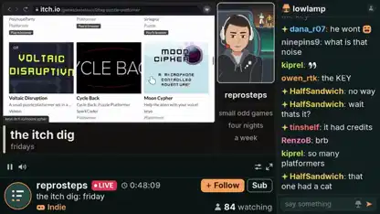

<!-- Generated by scripts/build.py. -->

# Un streamer ficticio juega a un plataformas de puzles real

[Volver a la colección](https://github.com/VibeClip/awesome-fable-5-2-videos/blob/main/README.es.md)

**[▶ Ver vídeo](https://video.twimg.com/amplify_video/2121780079818911744/vid/avc1/3840x2160/Si2gJV-V3_k7SLyG.mp4?tag=29)** · [Publicación original](https://x.com/kevin_t_ngo/status/2121780322106999106)

[kevin_t_ngo](https://x.com/kevin_t_ngo) · 2:08 · 2026-11-15

El autor atribuye a Fable 5.2 la creación del streamer ficticio. El vídeo lo muestra buscando un juego, jugando a Greed II de markmehere y reaccionando al chat. El juego es una obra de otro autor.

## Prompt compartido

No hay un prompt público registrado.

Fuentes y comprobaciones

- Evidencia del modelo: El modelo se menciona en la publicación original
- Accesibilidad de la publicación comprobada: 2026-11-15 — Publicación accesible

Comprobar el acceso a una publicación no equivale a reproducir su generación. La generación y el renderizado no se reprodujeron de forma independiente.

[Licencia y derechos del contenido](https://github.com/VibeClip/awesome-fable-5-2-videos/blob/main/docs/MEDIA-RIGHTS.md)

