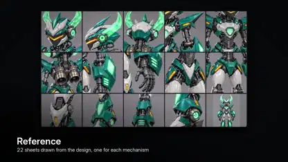

<!-- Generated by scripts/build.py. -->

# Un personaje mecánico creado en Blender

[Volver a la colección](https://github.com/VibeClip/awesome-fable-5-2-videos/blob/main/README.es.md)

**[▶ Ver vídeo](https://video.twimg.com/amplify_video/2123090716650065920/vid/avc1/1920x1080/XPzaGc3H-7uUSVhn.mp4?tag=29)** · [Publicación original](https://x.com/kevin_t_ngo/status/2123091419883831775)

[kevin_t_ngo](https://x.com/kevin_t_ngo) · 0:35 · 2026-11-18

El autor usó Fable 5.2 y AnyMachine. GPT Image 2.6 generó las referencias de las piezas y Blender se utilizó para construirlas mediante scripts.

## Prompt compartido

No hay un prompt público registrado.

Fuentes y comprobaciones

- Evidencia del modelo: El modelo se menciona en la publicación original
- Accesibilidad de la publicación comprobada: 2026-11-22 — Publicación accesible

Comprobar el acceso a una publicación no equivale a reproducir su generación. La generación y el renderizado no se reprodujeron de forma independiente.

[Licencia y derechos del contenido](https://github.com/VibeClip/awesome-fable-5-2-videos/blob/main/docs/MEDIA-RIGHTS.md)

