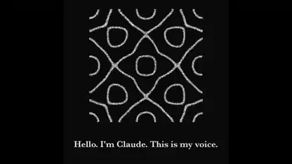

<!-- Generated by scripts/build.py. -->

# Una voz sintetizada en Python

[Volver a la colección](https://github.com/VibeClip/awesome-fable-5-2-videos/blob/main/README.es.md)

**[▶ Ver vídeo](https://video.twimg.com/amplify_video/2123979846556729344/vid/avc1/1080x1080/dZ3TQEILV-towceR.mp4?tag=29)** · [Publicación original](https://x.com/kevin_t_ngo/status/2123980980994318416)

[kevin_t_ngo](https://x.com/kevin_t_ngo) · 0:40 · 2026-11-21

El autor pidió a Fable 5.2 que creara una voz en Python.

## Prompt compartido

No hay un prompt público registrado.

Fuentes y comprobaciones

- Evidencia del modelo: El modelo se menciona en la publicación original
- Accesibilidad de la publicación comprobada: 2026-11-22 — Publicación accesible

Comprobar el acceso a una publicación no equivale a reproducir su generación. La generación y el renderizado no se reprodujeron de forma independiente.

[Licencia y derechos del contenido](https://github.com/VibeClip/awesome-fable-5-2-videos/blob/main/docs/MEDIA-RIGHTS.md)

