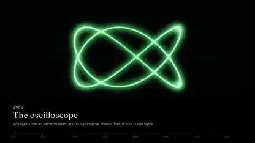

<!-- Generated by scripts/build.py. -->

# Una cronología visual de los gráficos por ordenador

[Volver a la colección](https://github.com/VibeClip/awesome-fable-5-2-videos/blob/main/README.es.md)

**[▶ Ver vídeo](https://video.twimg.com/amplify_video/2120642800303943680/vid/avc1/1920x1080/3NQuavTtjgfD_64R.mp4?tag=29)** · [Publicación original](https://x.com/kloss_xyz/status/2120644881790255276)

[kloss_xyz](https://x.com/kloss_xyz) · 1:50 · 2026-11-11

El autor publica una instrucción de una línea para Fable 5.2. El vídeo ilustra distintas técnicas con trazas de osciloscopio, esferas reflectantes y una habitación con trazado de caminos.

## Prompt compartido

Texto original compartido por el creador. Consulta la fuente para conocer el contexto y los materiales necesarios.

> Animate the history of computer graphics and render it in a 1080p 16:9 video.

[Leer el prompt del creador](https://x.com/kloss_xyz/status/2120644881790255276)

Fuentes y comprobaciones

- Evidencia del modelo: El modelo se menciona en la publicación original
- Accesibilidad de la publicación comprobada: 2026-11-14 — Publicación accesible

Comprobar el acceso a una publicación no equivale a reproducir su generación. La generación y el renderizado no se reprodujeron de forma independiente.

[Licencia y derechos del contenido](https://github.com/VibeClip/awesome-fable-5-2-videos/blob/main/docs/MEDIA-RIGHTS.md)

