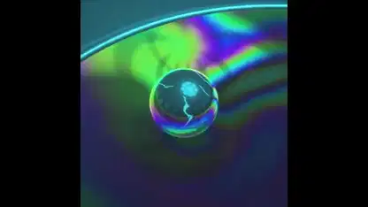

<!-- Generated by scripts/build.py. -->

# Vidrio iridiscente en un solo shader GLSL

[Volver a la colección](https://github.com/VibeClip/awesome-fable-5-2-videos/blob/main/README.es.md)

**[▶ Ver vídeo](https://video.twimg.com/amplify_video/2120689574079078400/vid/avc1/1080x1080/GQ2VNJwrUh4fKSoc.mp4?tag=29)** · [Publicación original](https://x.com/kloss_xyz/status/2120689622124798324)

[kloss_xyz](https://x.com/kloss_xyz) · 0:30 · 2026-11-12

El autor animó las imágenes en Python y las renderizó con un solo shader GLSL. Mezcló en Python grabaciones procedentes de bibliotecas de muestras.

[Publicación original](https://x.com/kloss_xyz/status/2120691788700910046)

## Prompt compartido

El creador compartió un prompt en el enlace siguiente. Consulta el contexto original, sus referencias y las instrucciones posteriores.

[Leer el prompt del creador](https://x.com/kloss_xyz/status/2120691788700910046)

Fuentes y comprobaciones

- Evidencia del modelo: El modelo se menciona en la publicación original
- Accesibilidad de la publicación comprobada: 2026-11-16 — Publicación accesible

Comprobar el acceso a una publicación no equivale a reproducir su generación. La generación y el renderizado no se reprodujeron de forma independiente.

[Licencia y derechos del contenido](https://github.com/VibeClip/awesome-fable-5-2-videos/blob/main/docs/MEDIA-RIGHTS.md)

