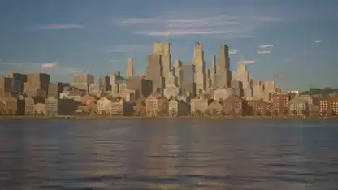

<!-- Generated by scripts/build.py. -->

# Una ciudad en Three.js del día a la noche

[Volver a la colección](https://github.com/VibeClip/awesome-fable-5-2-videos/blob/main/README.es.md)

**[▶ Ver vídeo](https://video.twimg.com/amplify_video/2121736588514197504/vid/avc1/3840x2160/1Rcr08kUxI-Q3eMQ.mp4?tag=29)** · [Publicación original](https://x.com/LexnLin/status/2121737343287828694)

[LexnLin](https://x.com/LexnLin) · 1:00 · 2026-11-14

El autor atribuye los gráficos hechos con código a Fable 5.2 y Three.js. El audio se incorporó por separado.

## Prompt compartido

No hay un prompt público registrado.

Fuentes y comprobaciones

- Evidencia del modelo: El modelo se menciona en la publicación original
- Accesibilidad de la publicación comprobada: 2026-11-16 — Publicación accesible

Comprobar el acceso a una publicación no equivale a reproducir su generación. La generación y el renderizado no se reprodujeron de forma independiente.

[Licencia y derechos del contenido](https://github.com/VibeClip/awesome-fable-5-2-videos/blob/main/docs/MEDIA-RIGHTS.md)

