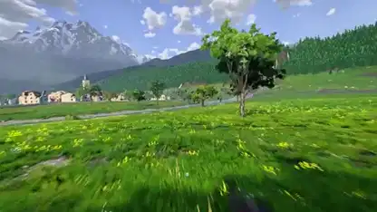

<!-- Generated by scripts/build.py. -->

# Valle Morta, un juego de supervivencia alpino

[Volver a la colección](https://github.com/VibeClip/awesome-fable-5-2-videos/blob/main/README.es.md)

**[▶ Ver vídeo](https://video.twimg.com/amplify_video/2121932247418781696/vid/avc1/3840x2160/pD4ekVQZGGrOVgAh.mp4?tag=29)** · [Publicación original](https://x.com/LexnLin/status/2121934071429468543)

[LexnLin](https://x.com/LexnLin) · 0:45 · 2026-11-15

El desarrollador usó Fable 5.2 como agente principal, con Opus 5.5 y Sonnet como subagentes. Creó el juego con Three.js y algunos modelos con Blender. La música y parte de los efectos proceden de terceros.

[Publicación original](https://x.com/LexnLin/status/2121934075229303036)

[Publicación original](https://x.com/LexnLin/status/2121934078408597998)

[Publicación original](https://x.com/LexnLin/status/2122012749664325903)

## Prompt compartido

No hay un prompt público registrado.

Fuentes y comprobaciones

- Evidencia del modelo: El modelo se menciona en la publicación original
- Accesibilidad de la publicación comprobada: 2026-11-16 — Publicación accesible

Comprobar el acceso a una publicación no equivale a reproducir su generación. La generación y el renderizado no se reprodujeron de forma independiente.

[Licencia y derechos del contenido](https://github.com/VibeClip/awesome-fable-5-2-videos/blob/main/docs/MEDIA-RIGHTS.md)

